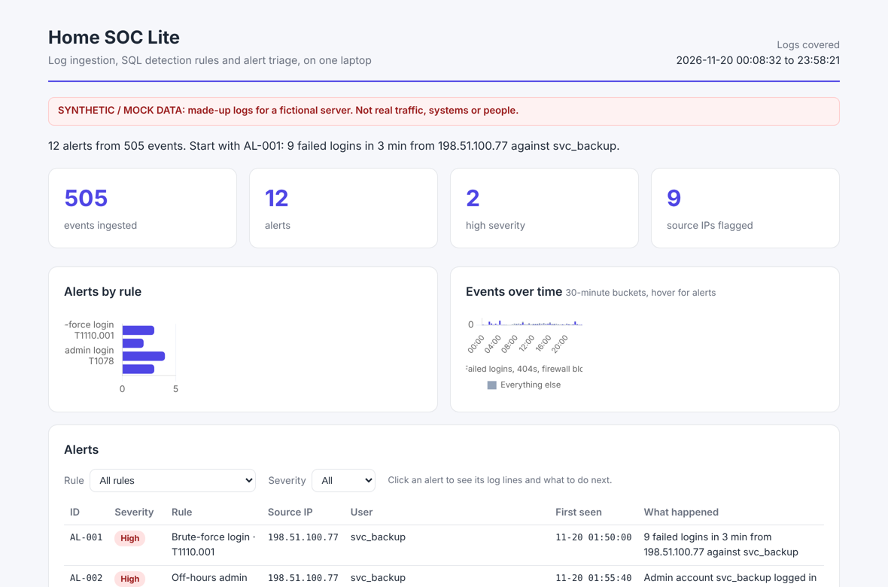
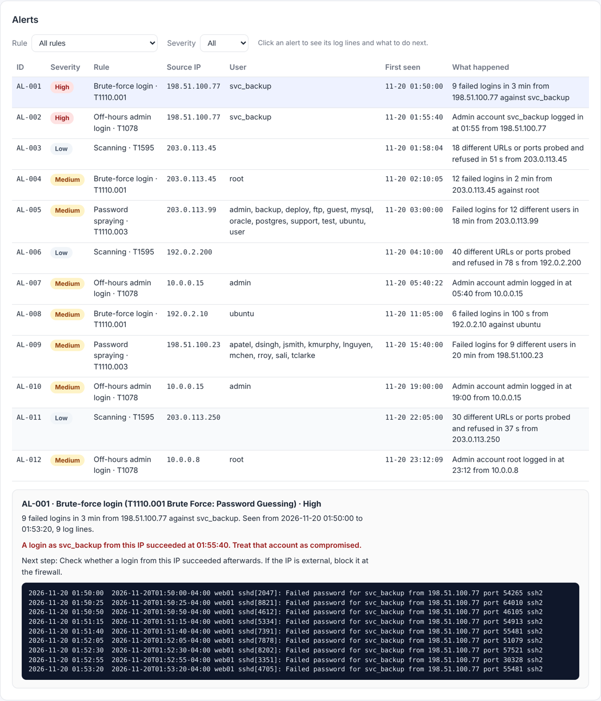

# Home SOC Lite

A small security operations centre (SOC) that runs on one laptop. It reads login, web server and firewall logs into SQLite, runs four detection rules written as SQL, groups the matches into alerts tagged with MITRE ATT&CK techniques, and shows them on a dashboard where each alert opens up to its raw log lines and a next step.

> **All logs in this repo are SYNTHETIC / MOCK.** `sample_logs/` was made by `make_sample_logs.py` for one day on a fictional server. It is not real traffic, systems or people. Outside IP addresses come from the documentation ranges 192.0.2.x, 198.51.100.x and 203.0.113.x (RFC 5737), which are never used on the real internet. The dashboard, the alerts CSV and the terminal output all carry a "SYNTHETIC / MOCK DATA" label.

There is no SIEM server, no Docker and no cloud account. It is Python, SQLite and FastAPI.

## What it detects

1. **Brute-force login** (MITRE ATT&CK T1110.001). One source IP fails to log in 5 or more times within 5 minutes. Someone is guessing a password.
2. **Password spraying** (T1110.003). One source IP fails logins for 8 or more different user names within 30 minutes. Instead of many passwords against one account, it is one or two common passwords against many accounts, slowly, to stay under lockout limits.
3. **Off-hours admin login** (T1078 Valid Accounts). An admin account logs in successfully before 07:00 or from 19:00 on. A stolen admin password looks exactly like a normal login, so the time of day is one of the few signs.
4. **Scanning** (T1595 Active Scanning). One source IP probes 15 or more different web paths (answered 404) or ports (blocked by the firewall) within 2 minutes. Someone is mapping what the server runs.

Two things raise an alert to **High**: a brute force or spray from an IP that then logs in successfully (the account should be treated as compromised), and an off-hours admin login from outside the internal network.

## Run it (3 commands)

Needs Python 3.9 or newer. The only packages are `fastapi` and `uvicorn`, for the local dashboard.

```bash
git clone https://github.com/EkinDeveci1907/home-soc-lite.git && cd home-soc-lite
python3 -m venv .venv && source .venv/bin/activate && pip install -r requirements.txt
python3 app.py
```

Then open http://127.0.0.1:8000. The first time, `app.py` loads the SYNTHETIC sample logs. The server only listens on 127.0.0.1, so nothing outside the computer can reach it.

Other commands:

```bash
python3 soc.py demo      # reload the sample logs and print the alerts in the terminal
python3 soc.py export    # write the static dashboard to docs/ for GitHub Pages
python3 -m unittest discover -s tests -v    # run the tests
python3 measure.py       # measure memory and disk use on this machine
```

The static copy of the dashboard in `docs/` is the same page with the data saved as `data.json`. GitHub Pages serves it as it is.

## Sample output

Terminal (`python3 soc.py demo`):

```
*** SYNTHETIC / MOCK DATA ***
Events in database: 505

Rule                        MITRE       Alerts
R1 Brute-force login        T1110.001        3
R2 Password spraying        T1110.003        2
R3 Off-hours admin login    T1078            4
R4 Scanning                 T1595            3
Total                                       12

AL-001  High    01:50:00  Brute-force login      9 failed logins in 3 min from 198.51.100.77 against svc_backup
                          ! A login as svc_backup from this IP succeeded at 01:55:40. Treat that account as compromised.
AL-002  High    01:55:40  Off-hours admin login  Admin account svc_backup logged in at 01:55 from 198.51.100.77
                          ! The login came from outside the internal network.
AL-003  Low     01:58:04  Scanning               18 different URLs or ports probed and refused in 51 s from 203.0.113.45
AL-004  Medium  02:10:05  Brute-force login      12 failed logins in 2 min from 203.0.113.45 against root
AL-005  Medium  03:00:00  Password spraying      Failed logins for 12 different users in 18 min from 203.0.113.99
AL-006  Low     04:10:00  Scanning               40 different URLs or ports probed and refused in 78 s from 192.0.2.200
AL-007  Medium  05:40:22  Off-hours admin login  Admin account admin logged in at 05:40 from 10.0.0.15
AL-008  Medium  11:05:00  Brute-force login      6 failed logins in 100 s from 192.0.2.10 against ubuntu
AL-009  Medium  15:40:00  Password spraying      Failed logins for 9 different users in 20 min from 198.51.100.23
AL-010  Medium  19:00:00  Off-hours admin login  Admin account admin logged in at 19:00 from 10.0.0.15
AL-011  Low     22:05:00  Scanning               30 different URLs or ports probed and refused in 37 s from 203.0.113.250
AL-012  Medium  23:12:09  Off-hours admin login  Admin account root logged in at 23:12 from 10.0.0.8

Wrote output/alerts.csv
```

Dashboard:



Alert table, with AL-001 opened to show its log lines and next step:



The alerts are also in [`sample_output/alerts.csv`](sample_output/alerts.csv).

## What was planted in the sample logs

`make_sample_logs.py` writes 528 log lines (146 auth, 287 web, 95 firewall) for 2026-11-20. Normal activity is random with a fixed seed: 15 staff logging in during the day with the odd typo, admins working office hours, about 200 web visits, and everyday internet noise hitting a few blocked ports. On top of that, these attacks were planted by hand, and the tool finds exactly these 12 alerts:

- **Brute force, 3:**
  - 198.51.100.77 tries `svc_backup` 9 times in 3 minutes 20 seconds, then the password works (High).
  - 203.0.113.45 tries `root` 12 times in under 3 minutes.
  - 192.0.2.10 tries `ubuntu`, a user that does not exist, 6 times.
- **Password spraying, 2:**
  - 203.0.113.99 tries 12 common user names, one every 100 seconds.
  - 198.51.100.23 tries 9 real staff names, one every 150 seconds.
- **Off-hours admin login, 4:**
  - `svc_backup` at 01:55 from 198.51.100.77, which is the brute force above succeeding (High).
  - `admin` at 05:40.
  - `admin` at exactly 19:00:00.
  - `root` at 23:12.
- **Scanning, 3:**
  - 192.0.2.200 requests 40 common attack paths (`/.env`, `/wp-login.php`, ...) in 78 seconds.
  - 203.0.113.45 requests 18 paths at 01:58, twelve minutes before it starts the brute force on `root`.
  - 203.0.113.250 hits 30 different firewall ports in under 40 seconds.

It also plants near misses that must **not** raise an alert: 4 failed logins in 3 minutes; 5 failures spread over just over 6 minutes; a spray of only 7 user names; admin logins at 07:00:00 and 18:59:59; a non-admin logging in at 02:00; one missing favicon requested 20 times; and a link checker finding 12 broken links. The test suite checks that the sample still gives 3 / 2 / 4 / 3.

## How the detection logic works

Every log line becomes one row in an `events` table:

```sql
CREATE TABLE events (
    id      INTEGER PRIMARY KEY,
    ts      TEXT,   -- local time, 'YYYY-MM-DD HH:MM:SS'
    source  TEXT,   -- auth, web, firewall, macos
    src_ip  TEXT,
    user    TEXT,
    event   TEXT,   -- login_failure, login_success, http_404, fw_block, ...
    detail  TEXT,   -- login method, URL path, or protocol/port
    raw     TEXT    -- the original line, kept as evidence
);
```

The rules below are **KQL-style queries translated to SQL**. Each one returns every event where its condition is true (a "hit"). `group_hits()` in [`rules.py`](rules.py) then joins hits for the same IP (or, for R3, the same user) that are less than 60 minutes apart into one alert, so one attack gives one alert, not one per failed login.

The windows are sliding: for every event, the query looks back over the window that ends at that event. "5 failures within 5 minutes" means the first and fifth failure are at most 5:00 apart, so 5 failures from 10:00:00 to 10:05:00 alert, and 10:00:00 to 10:05:01 do not.

### R1 Brute-force login (T1110.001)

```sql
SELECT * FROM (
    SELECT f.id, f.ts, f.src_ip, f.user,
           (SELECT COUNT(*) FROM events x
             WHERE x.event = 'login_failure'
               AND x.src_ip = f.src_ip
               AND x.ts BETWEEN datetime(f.ts, '-5 minutes') AND f.ts) AS window_count
    FROM events f
    WHERE f.event = 'login_failure'
)
WHERE window_count >= 5
```

### R2 Password spraying (T1110.003)

```sql
SELECT * FROM (
    SELECT f.id, f.ts, f.src_ip, f.user,
           (SELECT COUNT(DISTINCT x.user) FROM events x
             WHERE x.event = 'login_failure'
               AND x.src_ip = f.src_ip
               AND x.ts BETWEEN datetime(f.ts, '-30 minutes') AND f.ts) AS window_count
    FROM events f
    WHERE f.event = 'login_failure'
)
WHERE window_count >= 8
```

### R3 Off-hours admin login (T1078)

```sql
SELECT e.id, e.ts, e.src_ip, e.user
FROM events e
WHERE e.event = 'login_success'
  AND e.user IN (SELECT user FROM admin_accounts)
  AND (time(e.ts) < '07:00:00' OR time(e.ts) >= '19:00:00')
```

The admin accounts are listed in [`config/admin_accounts.txt`](config/admin_accounts.txt).

### R4 Scanning (T1595)

```sql
SELECT * FROM (
    SELECT p.id, p.ts, p.src_ip, p.user,
           (SELECT COUNT(DISTINCT x.event || ' ' || x.detail) FROM events x
             WHERE x.event IN ('http_404', 'fw_block')
               AND x.src_ip = p.src_ip
               AND x.ts BETWEEN datetime(p.ts, '-2 minutes') AND p.ts) AS window_count
    FROM events p
    WHERE p.event IN ('http_404', 'fw_block')
)
WHERE window_count >= 15
```

### How this compares with Microsoft Sentinel

This project does not use Microsoft Sentinel. The KQL named in this paragraph describes how the same rules are usually written there; it was not run. In Sentinel each rule would be a scheduled analytics rule written in KQL over a Log Analytics table, such as `SigninLogs` or `Syslog` for logins and `CommonSecurityLog` for firewall events. Brute force would be `summarize count() by IPAddress, bin(TimeGenerated, 5m) | where count_ >= 5`, spraying the same shape with `dcount(UserPrincipalName)` over 30 minutes, the off-hours rule a test of `hourofday(datetime_utc_to_local(TimeGenerated, "America/Halifax"))` against a watchlist of admin accounts, and scanning a `dcount()` of URLs or ports per IP over 2 minutes. What is different here: `bin()` cuts time into fixed buckets, so a burst that straddles two buckets can be missed, while these SQL queries use a sliding window (a subquery that looks back from every event), which catches it but does more work on large data; Sentinel groups matches into incidents and maps entities for you, while here `group_hits()` does the grouping in about 20 lines of Python; Sentinel stores time in UTC, while these logs keep the local time they were written in; and one SQLite file is fine for thousands of lines a day, not the millions a real SOC handles.

## Paste your own macOS logs

The `--macos` parser reads sshd and sudo lines from macOS `log show`, in the default style or `--style syslog`:

```bash
log show --last 1d --style syslog --predicate 'process BEGINSWITH "sshd" OR process == "sudo"' > my_mac.log
python3 soc.py ingest my_mac.log --macos --reset
python3 app.py
```

Or paste lines straight in with `python3 soc.py ingest - --macos --reset`, then Ctrl-D. sshd only writes logs if Remote Login is turned on in System Settings. The parser was tested on lines written in the `log show` format (`tests/fixture/macos.txt`); real output can vary between macOS versions. If macOS shows `<private>` in place of names, those lines cannot be parsed. Your own logs are not labelled SYNTHETIC, and they stay in `soc.db` on your machine (`.gitignore` keeps it out of git).

## Resource use

Measured on 2026-11-21 with `python3 measure.py` on a MacBook Air M2 (8 GB RAM), in a Linux shell running on that Mac (Python 3.10, arm64):

- Peak memory: **41 MB** (the largest single process, the dashboard server answering 50 page loads)
- Disk: **29 MB** in total, made up of 1 MB for the project and 28 MB for the `.venv` with FastAPI and uvicorn

Run `python3 measure.py` to get the numbers for your own machine.

## Tests

`python3 -m unittest discover -s tests -v` runs 24 tests on a small fixture in `tests/fixture/`, where every expected alert is written in a comment next to its log lines. The boundary cases:

- 4 failures in 5 minutes: no alert. 5 failures: alert. 5 failures spread over 5:01: no alert.
- 8 user names sprayed: alert. 7: no alert. 8 spread over 35 minutes: no alert.
- Admin login at 06:59:59: alert. 07:00:00: no alert. 18:59:59: no alert. 19:00:00: alert. A failed admin login at 06:58: no alert.
- 15 different 404 paths or blocked ports in 2 minutes: alert. 14: no alert. The same path 20 times: no alert.
- A brute force followed by a successful login from the same IP: High.
- sshd's "Invalid user" line is not counted as a second failure.

Changing any threshold by one (for example `>= 5` to `>= 4`, or `< '07:00:00'` to `<= '07:00:00'`) makes at least one test fail.

## Project layout

```
app.py                FastAPI server for the local dashboard
soc.py                command line: demo, ingest, alerts, export
parsers.py            turns auth, web, firewall and macOS log lines into events
store.py              the SQLite events table
rules.py              the four SQL rules, alert grouping and severity
dashboard_data.py     builds data.json for the dashboard
web/                  the dashboard page (index.html, style.css, app.js)
docs/                 static copy of the dashboard for GitHub Pages (SYNTHETIC data)
config/               admin account list for rule R3
make_sample_logs.py   rebuilds the SYNTHETIC sample logs
sample_logs/          SYNTHETIC auth, web and firewall logs
sample_output/        screenshots and alerts.csv from the sample
measure.py            measures memory and disk use
tests/                unittest suite and fixture logs
```

## Limits

This is a portfolio project, not a product. A real SOC would also need:

- Live collection. This reads log files you give it; it does not watch logs as they are written.
- More rules and tuning. The thresholds were chosen for this sample; real ones come from a baseline of normal traffic.
- Case management: assigning alerts, closing them, and tracking false positives.
- Time zones. Logs keep the local time they were written in, so logs from different time zones should not be mixed.
- Security on the dashboard itself. It has no login, which is fine only because it listens on 127.0.0.1. Log text is attacker-controlled, so the page inserts it with `textContent`, never as HTML.
